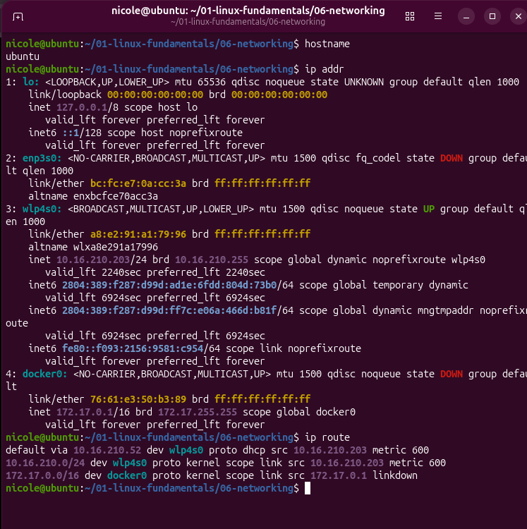

# 🌐 Networking

Laboratório prático de **fundamentos de redes no Linux**: identificação do hostname, das interfaces de rede, do endereço IP, da rede local, do gateway padrão e das rotas do sistema.

## 🎯 Objetivo

Identificar como a máquina está conectada à rede, praticando:

- identificação do nome da máquina (`hostname`)
- listagem de interfaces e endereços IP (`ip addr`)
- leitura da tabela de rotas e do gateway padrão (`ip route`)
- diferenciação entre interface física, loopback e interface virtual

## 🧰 Ambiente

- Distribuição: <!-- ex: Ubuntu 24.04 LTS -->
- Conexão: Wi-Fi
- Docker instalado

## 🛠️ Passo a passo

### 1. Identificar o hostname

```bash
hostname
```

```text
ubuntu
```

### 2. Listar interfaces e endereços IP

```bash
ip addr
```

Trecho relevante da saída:

```text
wlp4s0: ... state UP
    inet 10.16.210.203/24 ...
```

### 3. Consultar as rotas e o gateway

```bash
ip route
```

Trecho relevante da saída:

```text
default via 10.16.210.52 dev wlp4s0 ...
10.16.210.0/24 dev wlp4s0 ...
```

## 🔎 Resultados

### Identificação da máquina

| Item | Valor |
|------|-------|
| Hostname | `ubuntu` |
| Interface em uso | `wlp4s0` (Wi-Fi, ativa) |
| Endereço IPv4 | `10.16.210.203/24` |
| Rede local | `10.16.210.0/24` |
| Gateway padrão | `10.16.210.52` |

### Interfaces encontradas

| Interface | Tipo | Situação |
|-----------|------|----------|
| `wlp4s0` | Wi-Fi (física) | ativa, com IP `10.16.210.203/24` |
| `enp3s0` | Ethernet (física) | sem conexão |
| `lo` | loopback | comunicação interna da própria máquina |
| `docker0` | virtual (criada pelo Docker) | IP `172.17.0.1/16` |

## 🧠 Como interpretar

| Conceito | No laboratório |
|----------|----------------|
| **Endereço IP com máscara (`/24`)** | `10.16.210.203/24` indica que os 24 primeiros bits identificam a rede (`10.16.210.0`) e o restante identifica a máquina |
| **Rede local** | `10.16.210.0/24`: máquinas nesse bloco conversam diretamente, sem passar pelo gateway |
| **Gateway padrão** | `10.16.210.52`: para onde vai todo tráfego destinado a fora da rede local (rota `default`) |
| **Loopback (`lo`)** | interface interna, usada pela máquina para falar consigo mesma |
| **`docker0`** | bridge virtual criada pelo Docker, em uma rede própria (`172.17.0.0/16`), separada da rede Wi-Fi |

## 🔍 Troubleshooting

Perguntas que este laboratório já permite responder:

| Pergunta | Comando | Onde olhar |
|----------|---------|-----------|
| Qual interface está ativa? | `ip addr` | `state UP` |
| Qual é o meu IP? | `ip addr` | linha `inet` da interface ativa |
| Por onde sai o tráfego para fora da rede? | `ip route` | linha `default via` |
| Quais redes estão diretamente conectadas? | `ip route` | linhas com `dev <interface>` sem `via` |

## 📸 Evidência



## 🧠 Aprendizados

- `ip addr` mostra **quem eu sou** na rede (interfaces e IPs). `ip route` mostra **para onde o tráfego vai** (rotas e gateway).
- Uma máquina pode ter várias interfaces ao mesmo tempo, com situações diferentes (Wi-Fi ativa, Ethernet desconectada).
- Existem interfaces físicas, a de loopback e interfaces virtuais, como a do Docker.
- O `/24` define o tamanho da rede local, e o gateway é a saída para fora dela.

