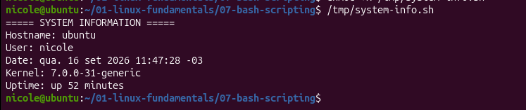

# 🐚 Bash Scripting

Laboratório prático de **scripts Bash no Linux**: criação de um primeiro script que coleta e exibe informações do sistema usando comandos que já existem na máquina.

## 🎯 Objetivo

Criar e executar um script Bash, praticando:

- shebang (`#!/bin/bash`) para definir o interpretador
- exibição de texto com `echo`
- substituição de comando com `$(...)`
- permissão de execução com `chmod +x`
- execução de um script pelo terminal

## 🧰 Ambiente

- Distribuição: <!-- ex: Ubuntu 24.04 LTS -->
- Shell: `bash`

## 🛠️ Passo a passo

### 1. Criar o script

Arquivo `system-info.sh`:

```bash
#!/bin/bash

echo "===== SYSTEM INFORMATION ====="

echo "Hostname: $(hostname)"
echo "User: $(whoami)"
echo "Date: $(date)"
echo "Kernel: $(uname -r)"
echo "Uptime: $(uptime -p)"
```

### 2. Dar permissão de execução

```bash
chmod +x /tmp/system-info.sh
```

### 3. Executar

```bash
/tmp/system-info.sh
```

Resultado esperado (exemplo, os valores mudam em cada máquina):

```text
===== SYSTEM INFORMATION =====
Hostname: ubuntu
User: <usuario>
Date: <data e hora atuais>
Kernel: <versão do kernel>
Uptime: up <tempo de atividade>
```

## 🔎 Como o script funciona

| Linha | O que faz |
|-------|-----------|
| `#!/bin/bash` | define que o script deve ser executado pelo Bash |
| `echo "===== ... ====="` | imprime o cabeçalho |
| `$(hostname)` | nome da máquina |
| `$(whoami)` | usuário que executou o script |
| `$(date)` | data e hora atuais |
| `$(uname -r)` | versão do kernel |
| `$(uptime -p)` | tempo de atividade em formato legível |

## 🧠 Conceitos praticados

| Conceito | Descrição |
|----------|-----------|
| **Shebang** (`#!/bin/bash`) | primeira linha do script, indica qual interpretador executa o arquivo |
| **Substituição de comando** (`$(...)`) | executa o comando dentro dos parênteses e insere a saída no lugar |
| **Permissão de execução** (`chmod +x`) | sem ela, o arquivo é só texto e não pode ser rodado como programa |

## 📸 Evidência



## 🧠 Aprendizados

- Um script Bash é uma sequência de comandos do sistema salva em arquivo.
- O shebang define quem interpreta o script, e o `chmod +x` permite executá-lo diretamente.
- Com `$(...)`, a saída de um comando pode ser reaproveitada dentro de outro.
- O Bash automatiza tarefas usando ferramentas que já fazem parte do Linux.
