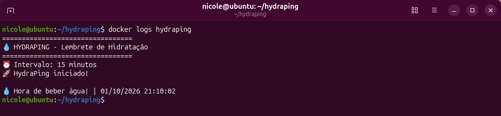

# 💧 HydraPing

Projeto prático desenvolvido durante meus estudos de Docker e DevOps.

O HydraPing é um lembrete de hidratação executado em um container Docker. O projeto registra os eventos em logs e utiliza um script no Ubuntu para gerar uma notificação no desktop.

## 🎯 Objetivo

Criar um pequeno serviço que:

- execute em um container Docker;
- registre os lembretes em logs;
- mantenha os logs persistentes;
- gere uma notificação no desktop Ubuntu;
- permita configurar o intervalo entre os lembretes.

## 🛠️ Tecnologias

- Linux / Ubuntu
- Docker
- Bash
- Volumes
- Logs
- AppArmor
- D-Bus
- notify-send

## 🐳 Primeira abordagem

Inicialmente, a ideia era fazer o próprio container acessar diretamente o sistema de notificações do Ubuntu através do D-Bus.

O objetivo era integrar o container ao sistema de notificações do host.

Durante os testes, essa abordagem foi bloqueada pelo AppArmor.

Erro encontrado:

```text
GDBus.Error:org.freedesktop.DBus.Error.AccessDenied
An AppArmor policy prevents this sender from sending this message

## 🔐 Investigação

O problema não estava no funcionamento do Docker ou do Bash.

O container estava tentando acessar um recurso protegido do sistema host.

O AppArmor impediu esse acesso de acordo com sua política de segurança.

Em vez de desabilitar o AppArmor, a solução foi alterar a arquitetura.

## 🔄 Nova abordagem

O container passou a ser responsável por gerar o evento e registrar a informação em um arquivo de log persistente.

Um script executado no Ubuntu monitora esse arquivo e gera a notificação.

A nova arquitetura separou as responsabilidades:

- Docker: executa o HydraPing;
- Volume: mantém os dados persistentes;
- Log: registra os eventos;
- Ubuntu: monitora o log;
- notify-send: exibe a notificação.

Essa abordagem evita que o container precise acessar diretamente o sistema de notificações do host.

## 📸 Resultado

### Notificação


### Container em execução


### Logs



Container em execução
Logs
📚 O que pratiquei
- criação de Dockerfile;
- construção de imagens;
- execução de containers;
- variáveis de ambiente;
- volumes;
- persistência de dados;
- análise de logs;
- Bash scripting;
- integração entre container e host;
- investigação de problemas;
- conceitos de segurança no Linux.
💡 Aprendizado
O principal aprendizado foi entender que fazer uma aplicação funcionar não significa necessariamente que a primeira abordagem seja a mais adequada.
Ao encontrar uma restrição de segurança, foi necessário investigar o motivo do bloqueio e adaptar a solução sem desabilitar a proteção do sistema.
Esse projeto também ajudou a compreender melhor a relação entre containers, sistema operacional, permissões e mecanismos de segurança do Linux.
