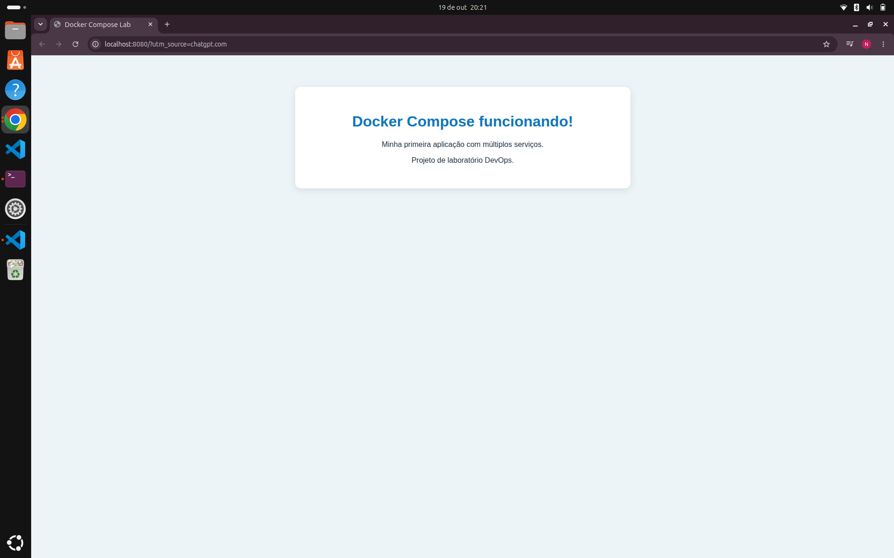

# 🐳 10 - Docker Compose

## 📌 Sobre o projeto

Este laboratório tem como objetivo praticar a construção e execução de uma aplicação web utilizando Docker e Docker Compose.

A aplicação utiliza o Nginx para disponibilizar uma página HTML personalizada por meio de um container.

## 🎯 Objetivos

- Construir uma imagem Docker a partir de um Dockerfile.
- Configurar um serviço utilizando Docker Compose.
- Compreender o mapeamento de portas.
- Executar e gerenciar containers.
- Consultar logs e verificar o estado dos serviços.

## 🛠️ Tecnologias utilizadas

- Docker
- Docker Compose
- Nginx
- HTML
- YAML
- Linux

## 📂 Estrutura do projeto

```text
10-docker-compose/
├── app/
│   ├── Dockerfile
│   └── index.html
├── compose.yaml
└── README.md
```

## ⚙️ Como executar

### 1. Construir a imagem

```bash
docker compose build
```

### 2. Iniciar a aplicação

```bash
docker compose up -d
```

### 3. Acessar no navegador

Abra:

http://localhost:8080

### 4. Verificar o serviço

```bash
docker compose ps
```

### 5. Consultar os logs

```bash
docker compose logs
```

### 6. Parar a aplicação

```bash
docker compose down
```

## 📸 Evidências do laboratório

### 1. Aplicação web funcionando



### 2. Construção e execução dos containers


## 🧠 Aprendizados

Durante este laboratório, pratiquei a construção de imagens Docker, a configuração de serviços com Docker Compose, o mapeamento de portas e o gerenciamento do ciclo de vida de containers.


