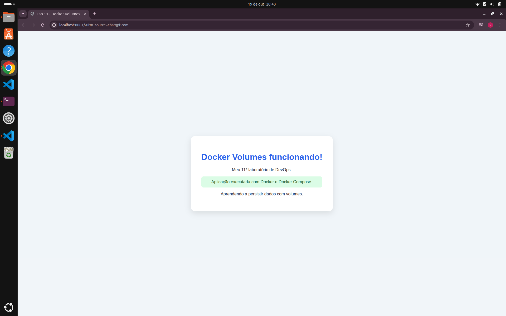
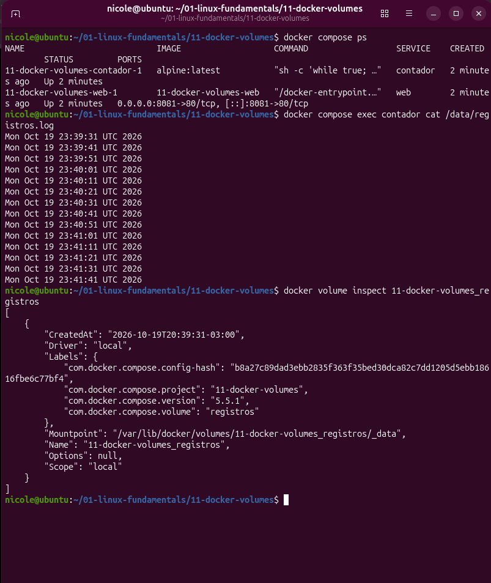
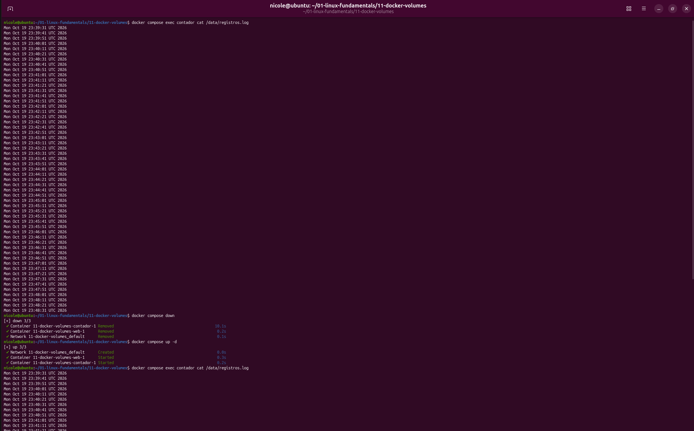

# 🐳 Lab 11 — Docker Volumes

## 📌 Sobre o projeto

Laboratório prático para estudar Docker Compose, múltiplos serviços e persistência de dados utilizando volumes do Docker.

## 🎯 Objetivos

- Construir uma imagem personalizada com Dockerfile.
- Executar serviços utilizando Docker Compose.
- Trabalhar com dois containers: uma aplicação web Nginx e um contador de registros.
- Criar e utilizar um volume persistente.
- Verificar os dados armazenados no volume.

## 🛠️ Tecnologias utilizadas

- Docker
- Docker Compose
- Nginx
- Alpine Linux
- HTML

## 🚀 Como executar

Construir a imagem da aplicação:

```bash
docker compose build
```

Iniciar os serviços:

```bash
docker compose up -d
```

Acessar a aplicação no navegador:

[http://localhost:8081](http://localhost:8081)

Verificar os containers:

```bash
docker compose ps
```

Consultar os registros:

```bash
docker compose exec contador cat /data/registros.log
```

Inspecionar o volume:

```bash
docker volume inspect 11-docker-volumes_registros
```

## 📸 Evidências do laboratório








## 📚 Aprendizados

Este laboratório demonstra como executar múltiplos serviços com Docker Compose e utilizar volumes nomeados para manter dados separados do ciclo de vida dos containers.


