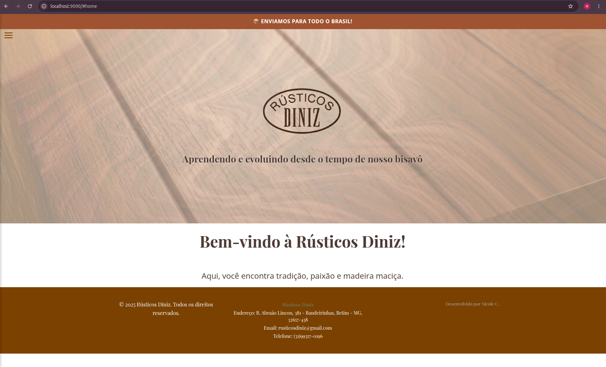
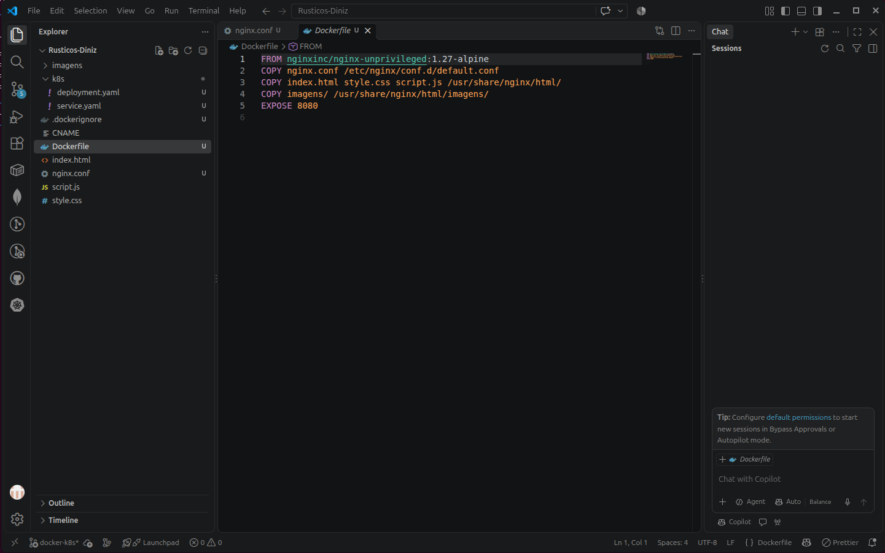
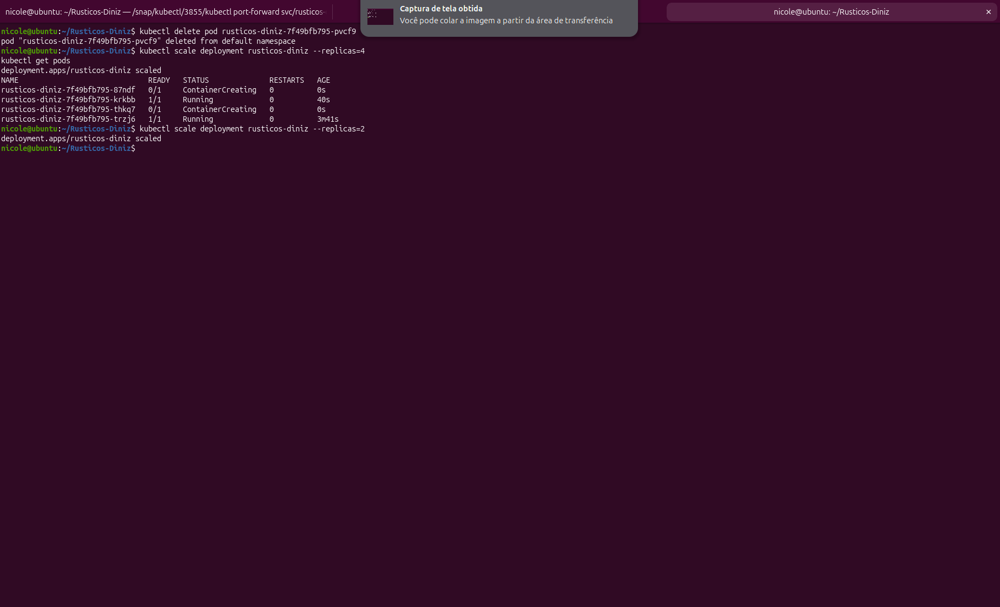

# 12: Kubernetes Fundamentals

Containerização de um site estático (o site institucional de uma marcenaria familiar, o **Rústicos Diniz**, que desenvolvi) com Docker e execução em um cluster Kubernetes local com **kind**.



*O site sendo servido em `localhost:9090`, a partir de um pod do Kubernetes.*

## O que pratiquei

- Criar uma imagem Docker para um site estático (nginx sem root)
- Criar um cluster Kubernetes local com kind
- Carregar uma imagem local dentro do cluster
- Escrever um `Deployment` com health checks, limites de recursos e `securityContext`
- Expor os pods com um `Service`
- Acessar o site com `kubectl port-forward`
- Observar a autorrecuperação (um pod removido é recriado sozinho)
- Escalar o Deployment com `kubectl scale`
- Investigar erros com `kubectl describe` e `kubectl logs`

## Arquitetura

```
Navegador ──► port-forward ──► Service (porta 80) ──► Pods (2 réplicas) ──► nginx (porta 8080) ──► site estático
```

## Estrutura da pasta

```
12-kubernetes-fundamentals/
├── Dockerfile
├── nginx.conf
├── .dockerignore
├── .gitignore
├── k8s/
│   ├── deployment.yaml
│   └── service.yaml
├── docs/img/            # prints deste laboratório
└── README.md
```



## Pré-requisito: arquivos do site

O código do site fica em outro repositório ([Rusticos-Diniz](https://github.com/nicolejsdev/Rusticos-Diniz)) e **não é versionado aqui**, para não duplicar cerca de 90 MB de fotos. Para reproduzir, copie para esta pasta:

```bash
cp -r ~/Rusticos-Diniz/index.html ~/Rusticos-Diniz/style.css ~/Rusticos-Diniz/script.js ~/Rusticos-Diniz/imagens .
```

O `.gitignore` desta pasta impede que esses arquivos entrem em um commit sem querer.

## Como rodar

Pré-requisitos: Docker, kubectl e kind instalados.

### Somente Docker

```bash
docker build -t rusticos-diniz:1.0.0 .
docker run --rm -p 9090:8080 rusticos-diniz:1.0.0
```

Acesse `http://localhost:9090`. O health check responde em `http://localhost:9090/healthz`.

### Kubernetes (kind)

```bash
kind create cluster --name estudo
kind load docker-image rusticos-diniz:1.0.0 --name estudo
kubectl apply -f k8s/
kubectl get pods
kubectl port-forward svc/rusticos-diniz 9090:80
```

Para remover tudo: `kind delete cluster --name estudo`.


## Experimentos

### Autorrecuperação

Apaguei um dos pods com `kubectl delete pod <nome>` enquanto acompanhava com `kubectl get pods -w`. O Kubernetes criou um pod novo para voltar às 2 réplicas definidas no Deployment, e o site continuou respondendo.


### Escalonamento

```bash
kubectl scale deployment rusticos-diniz --replicas=4
kubectl scale deployment rusticos-diniz --replicas=2
```



## Problemas encontrados e como resolvi

**1. `Bind for 0.0.0.0:8080 failed: port is already allocated`**
Causa: o container do laboratório 10 (`10-docker-compose-web-1`) já usava a porta 8080 do computador.
Investigação: `docker ps` mostrou o container com `0.0.0.0:8080->80/tcp`.
Solução: mapear outra porta, `-p 9090:8080`.

**2. `ERROR: failed to build: Canceled: context canceled`**
Causa: o build foi interrompido enquanto baixava a imagem base, porque mexi no terminal durante a execução.
Solução: rodar o `docker build` de novo e esperar terminar sem interagir. O Docker aproveitou as camadas já baixadas.

**3. `kind create cluster` muito lento na primeira vez**
Causa: o kind precisa baixar a imagem do nó (`kindest/node`), que é grande, e minha conexão é lenta.
Solução: baixar antes com `docker pull kindest/node:v1.31.0`, que mostra a barra de progresso, e depois `kind create cluster --name estudo --image kindest/node:v1.31.0`.

**4. Pasta `k8s/k8s` aninhada**
Causa: ao criar a pasta no VS Code, ela ficou dentro de outra de mesmo nome, então `kubectl apply -f k8s/` não encontraria os arquivos.
Solução: `mv k8s/k8s/* k8s/ && rmdir k8s/k8s`.

**5. O cluster não enxerga as imagens do Docker local**
O nó do kind é um container separado. Foi preciso carregar a imagem com `kind load docker-image`.

## Decisões técnicas

- **Imagem sem root:** `nginxinc/nginx-unprivileged`, com `runAsNonRoot` e `allowPrivilegeEscalation: false`.
- **Health checks:** endpoint `/healthz` no nginx, usado pela `readinessProbe` (só recebe tráfego quando está pronto) e pela `livenessProbe` (reinicia se travar).
- **Recursos limitados:** `requests` e `limits` de CPU e memória em cada pod.
- **Versão fixa da imagem:** tag `1.0.0` em vez de `latest`.
- **Cache de imagens:** `expires 30d` para `.jpg`, `.jpeg`, `.png` e `.webp`.

## O que aprendi

- Um Deployment descreve o estado desejado (2 réplicas) e o Kubernetes trabalha continuamente para mantê-lo.
- O Service dá um endereço estável para pods que mudam de nome e de IP.
- Probes são o que permite ao cluster saber se um container está saudável.
- A maioria dos erros se resolve lendo a saída de `kubectl describe pod` e `kubectl logs`.

## Próximos passos

- [ ] Pipeline no GitHub Actions para construir e publicar a imagem no GitHub Container Registry
- [ ] Ingress para acesso por nome de host
- [ ] Parametrizar os manifests com Kustomize ou Helm
- [ ] Reduzir o peso das imagens do site (WebP e redimensionamento)

⬅️ [Voltar ao índice do DevOps Lab](../README.md)
